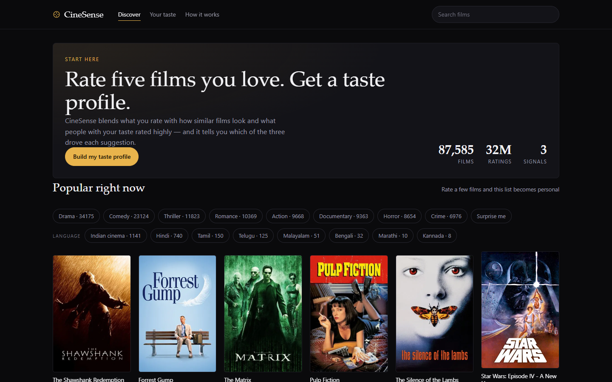
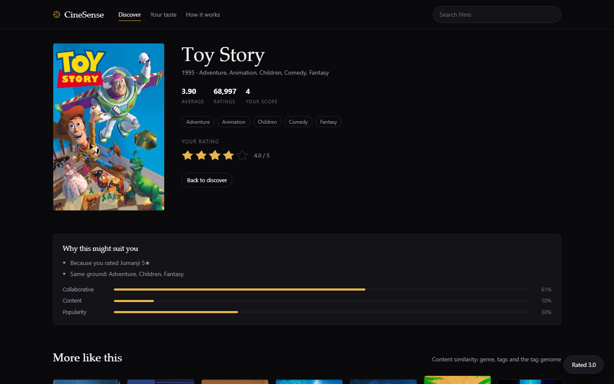

# CineSense

A movie recommender that explains itself. It blends what you rate, what films are
actually like, and what people with similar taste rated highly, then tells you
which of the three drove each suggestion.

**Live:** https://cinesense-mu.vercel.app



---

## What it does

You rate a handful of films. CineSense builds a taste profile from them and
returns a ranked list where every entry carries a reason: the film you rated that
it is closest to, the genres and themes they share, and a breakdown of how much
each signal contributed.

Five screens:

- **Discover**: recommendations, genre and language filters, and a fingerprint of
  the genres your ratings concentrate in
- **Film**: poster, crowd average, your rating, a "why this might suit you" panel
  with contribution bars, plus content neighbours and collaborative neighbours
- **Your taste**: genre distribution, the average signal mix behind your
  recommendations, and every rating editable in place
- **How it works**: the model's measured ranking quality, read live from the build
  artifacts rather than hardcoded
- **Onboarding**: pick films you love, optionally a genre and era, then start

Ratings are the only input, and they stay in your browser. The API is stateless:
it scores whatever it is handed and forgets it. There is no account, no session
and no database.



## The recommendation model

Three signals, blended per request:

| Signal | What it measures | How |
| --- | --- | --- |
| Collaborative | What people with similar taste rated highly | Biased matrix factorisation over 32M ratings |
| Content | What a film is like | TF-IDF over title, genres and tags, plus the MovieLens tag genome, reduced by LSA |
| Popularity | How widely rated a film is | Log rating count, weighted lightly |

Scores are z-scored before blending. Content similarity lives in [-1, 1], a
collaborative prediction in [0.5, 5], and popularity is a count; adding them raw
would let whichever has the largest numbers win regardless of the configured
weights. Weights live in `configs/base.toml`.

Ranking is followed by maximal marginal relevance, which stops a result list
repeating itself. A cold start path seeds a profile from onboarding picks without
a separate code path.

```
OFFLINE   MovieLens 32M + TMDB  -->  content features  -->  LSA vectors
                                -->  rating matrix     -->  SVD factors

RUNTIME   your ratings  -->  fold-in  -->  blend(content, collaborative, popularity)
                                     -->  MMR  -->  ranked list with explanations
```

## Results

Measured on a held-out 10% of ratings that the shipped model never trained on.

**Prediction accuracy.** 28.5M training interactions, 3.2M held out, 64 factors.

| | RMSE |
| --- | --- |
| Bias baseline (user and item offsets only) | 0.8543 |
| With latent factors | **0.8167** |

**Ranking quality.** NDCG@10 against held-out likes, 300 users.

| Variant | NDCG@10 | Precision@10 |
| --- | --- | --- |
| Popularity only | 0.1183 | 0.0750 |
| Content only | 0.0267 | 0.0170 |
| Collaborative only | 0.0556 | 0.0343 |
| **Hybrid (shipped)** | **0.1317** | **0.0760** |

The content-only row is the interesting one. It scores below popularity, because
content similarity answers "what is this like", not "what will I rate highly". It
is the right tool for "more like this" and the wrong tool for a ranking. Blending
is what makes both useful at once: the hybrid beats the best single signal by
11.3%.

**Dataset.** 87,585 films, 32,000,204 ratings, 200,948 users, 99.82% sparse.
43,129 films carry TMDB metadata, including language and country.

**Shipped artifacts.** 32.3 MB, of which 31.0 MB is content and collaborative
model data. The remainder is the catalogue, poster index and build manifests.

## Architecture

The split between offline and runtime is enforced, not conventional. The serving
process imports numpy and the standard library only, so pandas, scikit-learn and
scipy never enter the deployed bundle. `tests/test_dependency_split.py` fails the
build if that slips.

```
src/cinesense/
    config.py      typed settings from configs/base.toml; rejects unknown keys
    cli.py         python -m cinesense ...
    data/          offline only: download, duckdb ingest, preprocess, genome, TMDB
    features/      offline only: TF-IDF and LSA, SVD training, offline evaluation
    recommend/     runtime: content index, fold-in scoring, blend, explanations
    serving/       FastAPI app, routes, schemas, static frontend

api/index.py       Vercel entrypoint
artifacts/         model files committed so deploys never train anything
```

| Endpoint | Purpose |
| --- | --- |
| `GET /api/health` | liveness and which models loaded |
| `GET /api/stats` | dataset and model metrics |
| `GET /api/facets` | language and country filters with counts |
| `GET /api/genres` | genre filters with counts |
| `GET /api/search?q=` | title search |
| `GET /api/movies/{id}` | metadata and top terms |
| `POST /api/movies` | bulk metadata lookup |
| `GET /api/movies/{id}/similar` | content neighbours |
| `GET /api/movies/{id}/related` | collaborative neighbours |
| `POST /api/recommendations` | hybrid results with explanations |

The frontend is plain HTML, CSS and ES modules served by FastAPI. No build step
and no webfonts, so nothing flashes and the deployment does not depend on Node.

## Running it

Requires Python 3.12, which matches the deployment runtime.

```powershell
py -3.12 -m venv .venv
.\.venv\Scripts\python.exe -m pip install -r requirements-dev.txt
```

The `python` on PATH may be a different version without the data libraries.
`scripts/dev.ps1` always uses `.venv`.

Build the models. Each step caches and is safe to re-run.

```powershell
.\scripts\dev.ps1 build-catalog    # download, ingest, validate     ~2-4 min first run
.\scripts\dev.ps1 build-features   # text features and vectors       ~3 min
.\scripts\dev.ps1 build-model      # collaborative factors           ~80 s
.\scripts\dev.ps1 fetch-posters    # TMDB metadata (needs a key)
```

Serve it:

```powershell
.\.venv\Scripts\python.exe -m uvicorn cinesense.serving.app:app --port 8011
```

Ask it something:

```powershell
.\scripts\dev.ps1 similar --movie "The Godfather" -k 8
.\scripts\dev.ps1 recommend --user 1 -k 8
.\scripts\dev.ps1 recommend --rate "Inception=5" --rate "The Matrix=1" -k 8
.\scripts\dev.ps1 recommend --like "Inception" --genre "Sci-Fi" -k 8
```

Evaluate:

```powershell
.\scripts\dev.ps1 eval -k 10 --sample 400            # content: genre agreement
.\scripts\dev.ps1 eval --ranking -k 10 --users 300   # NDCG and precision
```

Test:

```powershell
.\.venv\Scripts\python.exe -m pytest              # 192 tests, no network
.\.venv\Scripts\python.exe scripts\check_ui.py    # 29 browser checks
```

The browser checks accept a deployed URL:

```powershell
$env:CINESENSE_BASE = "https://cinesense-mu.vercel.app"
.\.venv\Scripts\python.exe scripts\check_ui.py
```

### Posters and metadata

A free TMDB key provides real posters and the language and country filters. It is
used once, offline, and never at runtime.

```powershell
# TMDB_API_KEY=your_key in .env
.\scripts\dev.ps1 fetch-posters
```

The fetch stores only the image path and the film's language and country. The
browser then loads posters from TMDB's CDN, so serving needs no key, makes no API
calls and cannot be rate limited. Without a key the interface falls back to
generated monogram cards, so nothing is ever blank.

Both TMDB credential formats work: the v3 API key and the v4 read access token.

## Deployment

Vercel, Python runtime, no environment variables. `vercel.json` routes all traffic
to `api/index.py`, which loads the model once per instance.

Measured on the live deployment: 2.1 s cold start, around 1 s warm.

## Engineering decisions

These are the choices that were not obvious, and the reasoning behind each.

**Only item factors ship.** Storing 200,948 user factors would cost 51 MB and
still could not serve anyone outside MovieLens. The runtime folds a user's ratings
into a vector at request time, using the same algebra, in 11 MB. It works for a
user who has rated three films.

**No precomputed neighbour table.** Scoring 87,585 films against one 96-dimension
vector is a few million multiply-adds. Shipping vectors costs 16 MB; shipping
stored neighbours would cost more and go stale on every rebuild.

**LSA exists for size, not quality.** The sparse text matrix is 17.9 GB dense.
Ninety-six latent dimensions ship as 16 MB float16.

**The evaluated model is the shipped model.** Ten percent of ratings are held out
before training, and every number above comes from that held-out set. Training a
second production model on all the data would score better and prove nothing.

**duckdb, not `pandas.read_csv`.** Thirty-two million rows through pandas spikes
several gigabytes. duckdb streams the CSVs into parquet inside a fixed memory
ceiling; peak RSS for a full build is 871 MB.

**Quality gates fail the build.** If ratings collapse or coverage drops,
`build-catalog` exits non-zero rather than producing a quietly worse model.

**Tags are stored whole.** An earlier version capped tag text at 400 characters.
Because tags are sorted alphabetically, that silently kept only tags starting with
"a" to "d" on popular films.

**Dislikes exclude; they do not anti-recommend.** Mean-centring ratings meant a
one-star review subtracted that film's vector, pushing the profile away from
Sci-Fi and Action, which is nearly the whole catalogue, and surfacing obscure
crime dramas. Ratings below neutral now carry no weight and are simply excluded.

## Limits

- **No plot understanding.** The model knows genres, the words people tag a film
  with, and 1,128 semantic scores from the tag genome. It cannot read a synopsis.
- **The catalogue is Western-skewed.** MovieLens is dominated by US and UK cinema;
  films tagged as Indian hold 0.28% of all ratings. Language filters make 1,141
  Indian films reachable, but films absent from the dataset cannot be recommended
  at all.
- **Sparse films are weakly modelled.** Collaborative factors are trained on films
  with 30 or more ratings. Anything below is ranked by content and popularity only.
- **No persistence.** Your ratings exist in one browser. Clearing site data
  removes the profile permanently.

## Data

Ratings, tags and the tag genome from [MovieLens](https://grouplens.org/datasets/movielens/)
32M and 25M, published by GroupLens Research at the University of Minnesota.
Poster images and metadata from TMDB. This product uses the TMDB API but is not
endorsed or certified by TMDB.
